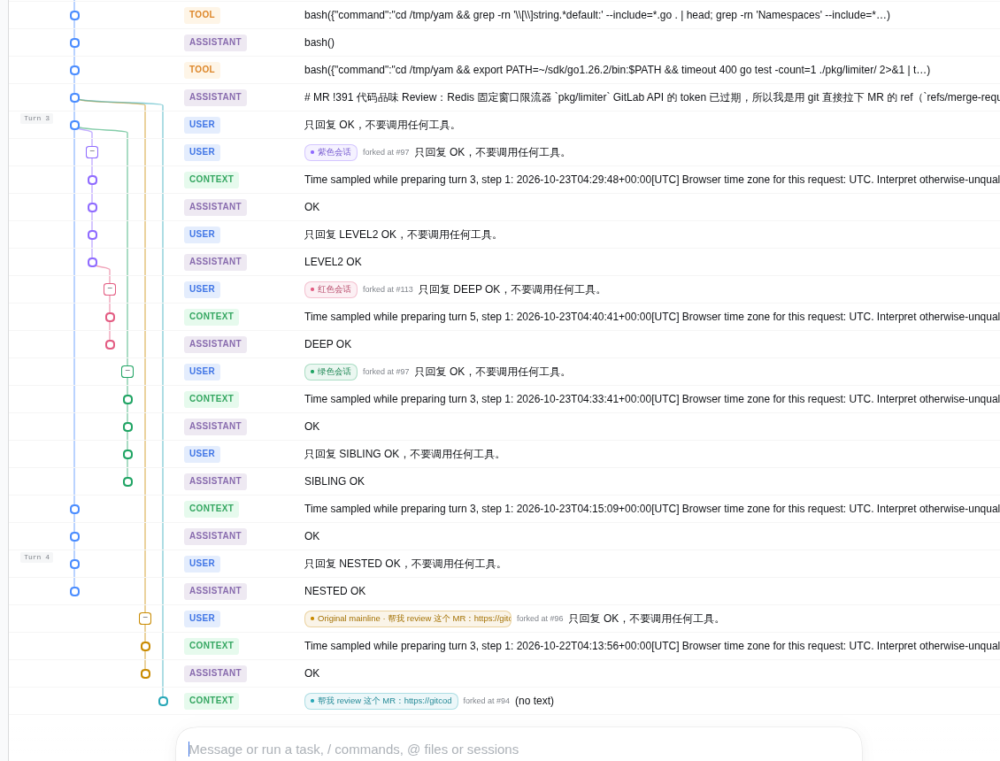

# @gitsang/dsh-qol

面向 [DeepSeek Harness](https://github.com/deepseek-ai/deepseek-harness) 的体验改进工具箱。

## 安装

```bash
dsh plugin --profile web add @gitsang/dsh-qol
```

## 包含的组件

每个组件可在插件配置详情页中单独开关，部分组件可进入组件详情页继续详细配置。

| 包名                                            | 作用                                                                         | 截图                                                                                  |
| ----------------------------------------------- | ---------------------------------------------------------------------------- | ------------------------------------------------------------------------------------- |
| `@gitsang/dsh-enter-swap`                       | 支持调换为 Enter 换行，Ctrl/Cmd+Enter 发送。                                 |                                                                                       |
| `@gitsang/dsh-no-preview-notice`                | 跳过新会话页的版本预览提示。                                                 |                                                                                       |
| `@gitsang/dsh-experimental-auto-review-enhance` | 配置 Auto review 为新会话默认值，可选择拒绝理由语言、是否返回理由给会话 AI。 |                                                                                       |
| `@gitsang/dsh-reset-terminals`                  | 提供 `/reset-terminals` 和输入框按钮，关闭持久 PTY 会话，以便切换权限。      |                                                                                       |
| `@gitsang/dsh-sidebar-terminal-enhance`         | 设置右侧终端的字体族、字号、行高，以及浅色/深色/跟随外观的主体色。           |                                                                                       |
| `@gitsang/dsh-statusline`                       | 状态栏展示更详细的会话统计数据。                                             |                                                                                       |
| `@gitsang/dsh-session-tree`                     | 新增「轨迹树」标签页，并可从任意持久事件分叉，编辑旧消息后从该步之前分叉。   |  |

组件特殊说明：

- `@gitsang/dsh-experimental-auto-review-enhance` 需要同时启用 `@deepseek-ai/dsh-experimental-auto-review`；

## 开发

```bash
pnpm install
pnpm -r --if-present test
```

## License

MIT
